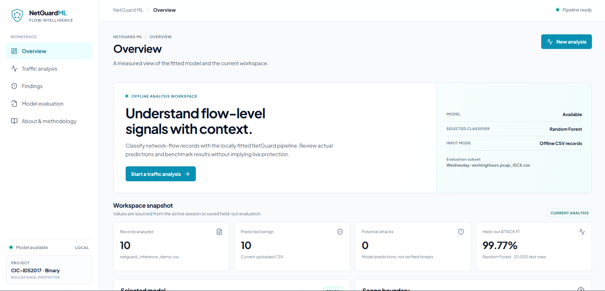
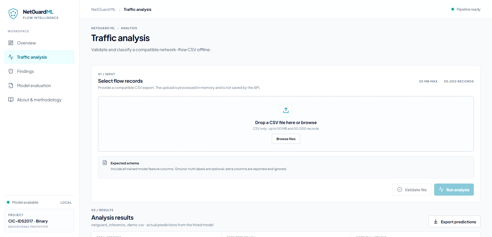
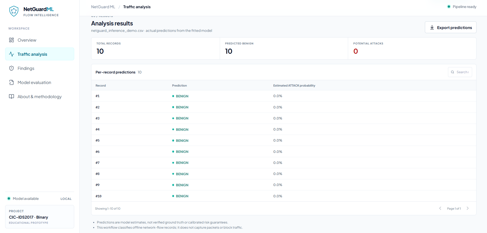
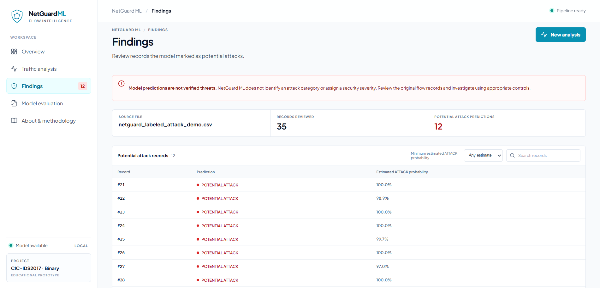
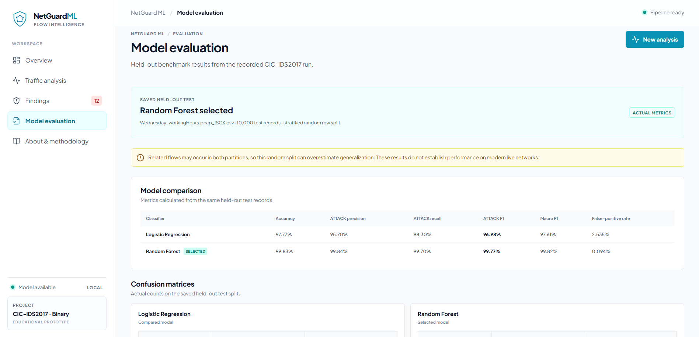
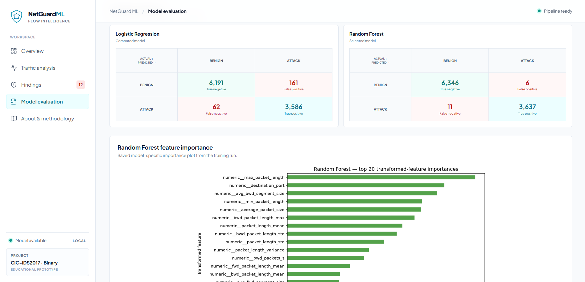
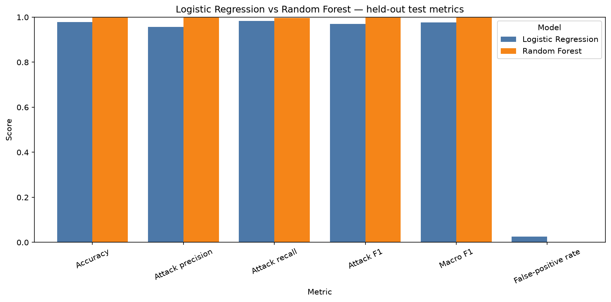
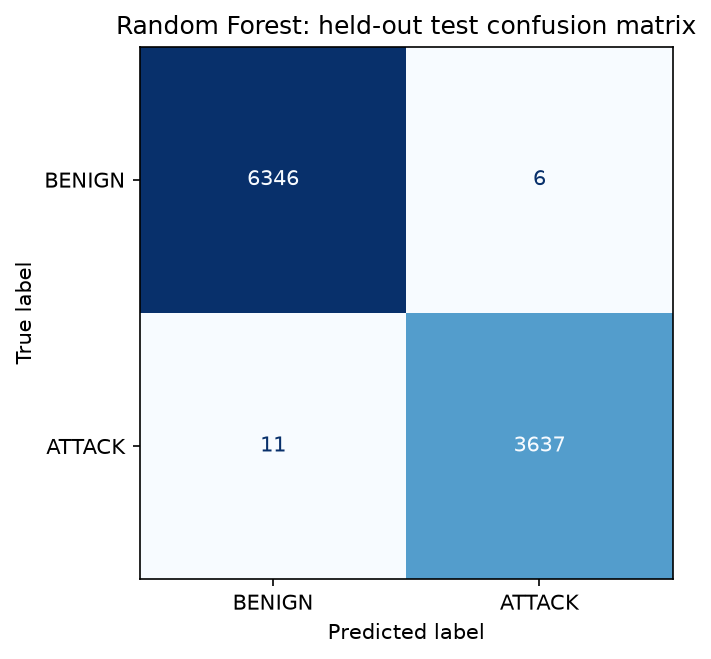

<div align="center">
  
  <h1>NetGuard ML</h1>
  <p><strong>Offline, binary network-flow classification with CIC-IDS2017</strong></p>
  <p>
    
    
    
    
  </p>
</div>

NetGuard ML is an educational cybersecurity prototype developed for the **IBM
SkillsBuild Cyber Security Bootcamp 2026, conducted by BharatCares**. It
explores a reproducible machine-learning workflow for classifying labeled
CIC-IDS2017 network-flow records as **BENIGN (0)** or **ATTACK (1)**. An
optional local web interface uses the same saved model to classify compatible
CSV files.

> [!WARNING]
> This is an offline educational prototype. It does not capture packets,
> monitor live networks, block traffic, or provide a production security
> control. Predictions and probability estimates are not verified threats or
> calibrated risk scores.

## Contents

- [Highlights](#-highlights)
- [Application screenshots](#-application-screenshots)
- [Dataset and methodology](#-dataset-and-methodology)
- [Recorded benchmark results](#-recorded-benchmark-results)
- [Quick start: notebook](#-quick-start-notebook)
- [Run the local web interface](#-run-the-local-web-interface)
- [Use a CSV for offline inference](#-use-a-csv-for-offline-inference)
- [Repository map](#-repository-map)
- [Limitations and responsible interpretation](#-limitations-and-responsible-interpretation)
- [Project report and credits](#-project-report-and-credits)

## 🛡️ Highlights

- **Bounded data loading:** reads CIC-IDS2017 CSV data in chunks and uses a
  seeded, class-proportional sample capped at 50,000 rows.
- **Binary scope:** maps `BENIGN` to `0`; maps each observed non-empty attack
  label to `1`.
- **Leakage-aware preprocessing:** fits imputation, scaling, and encoding on
  training data only, inside a scikit-learn pipeline.
- **Two comparable classifiers:** trains Logistic Regression and Random
  Forest on the same stratified train/test split; applies class weights rather
  than automatic resampling.
- **Reusable inference:** persists the preprocessing and selected estimator
  together in a joblib pipeline.
- **Optional local UI/API:** validates a compatible CSV, runs the saved
  pipeline, and presents per-record predictions and the recorded benchmark.
  Uploaded CSVs are processed in memory and not stored by the API.

## 🖥️ Application screenshots

The following images are screenshots included in the supplied
`NetGuard ML outputs.docx`; selected screenshots are also included in
[`docs/images/`](docs/images/). They show the implemented local interface and
its current demonstration states.

<details>
<summary>View overview, analysis, findings, and evaluation screens</summary>

### Overview



### Traffic analysis



### Example inference results



### Labeled demonstration findings



### Model evaluation view



### Confusion matrices and feature importance



</details>

## 🧪 Dataset and methodology

### Dataset source

The project uses **CIC-IDS2017**, published by the Canadian Institute for
Cybersecurity at the University of New Brunswick. See the
[official dataset page](https://www.unb.ca/cic/datasets/ids-2017.html). The
notebook does not download the dataset. Obtain the CSV separately and place it
under `data/raw/`.

The recorded run used only
`Wednesday-workingHours.pcap_ISCX.csv`:

| Run detail | Recorded value |
| --- | ---: |
| Source rows scanned and eligible | 692,703 |
| Bounded modeling sample | 50,000 |
| BENIGN / ATTACK sample rows | 31,762 / 18,238 |
| Train / held-out test rows | 40,000 / 10,000 |
| Split | Stratified random row-level, 80/20 |
| Random seed | 42 |
| Input features | 78 |

### Data preparation

The notebook normalizes column names and labels, reports schema and data
quality, and streams the CSV in 100,000-row chunks. It excludes identifiers,
raw timestamps, and label-/outcome-like fields. Numeric missing values are
imputed with training medians and standardized; categorical fields are
imputed and one-hot encoded in the fitted pipeline. Infinite values are
handled as missing during training; the inference workflows reject infinite
numeric inputs. Duplicate flow rows are counted but not removed because
duplicate values alone do not establish that records are invalid.

The test partition is held out from fitting and model selection. Both models
use class weighting (`balanced` for Logistic Regression and
`balanced_subsample` for Random Forest); no resampling is applied.

## 📊 Recorded benchmark results

These metrics are from the **10,000-row held-out test split** in the recorded
Wednesday subset run, with ATTACK treated as the positive class. They are
included to describe that run, not to predict performance on other files or
live networks.

| Model | Accuracy | ATTACK precision | ATTACK recall | ATTACK F1 | Macro F1 | False-positive rate |
| --- | ---: | ---: | ---: | ---: | ---: | ---: |
| Logistic Regression | 0.9777 | 0.9570 | 0.9830 | 0.9698 | 0.9761 | 0.02535 |
| **Random Forest (selected)** | **0.9983** | **0.9984** | **0.9970** | **0.9977** | **0.9982** | **0.000945** |

The selection rule prioritizes higher ATTACK F1, then higher ATTACK recall,
then lower false-positive rate; exact ties favor Logistic Regression. The
selected Random Forest's test confusion counts were **6,346 true negatives,
6 false positives, 11 false negatives, and 3,637 true positives**. False
positives are benign records flagged as attacks; false negatives are attack
records predicted benign.

<p align="center">
  
</p>
<p align="center">
  
</p>

Additional reports and figures are in [`outputs/reports/`](outputs/reports/)
and [`outputs/figures/`](outputs/figures/). The updated
[project report](RianRenju_ProjectReport.docx) contains the methodology,
results, verification notes, and limitations.

## 🚀 Quick start: notebook

### 1. Obtain the dataset

Download CIC-IDS2017 from the
[official dataset page](https://www.unb.ca/cic/datasets/ids-2017.html). Place
the selected CSV at:

```text
data/raw/Wednesday-workingHours.pcap_ISCX.csv
```

Alternatively, set `CIC_IDS2017_CSV` to the absolute path of a local CSV. Raw
dataset files are not committed to Git.

### 2. Create an environment and install notebook dependencies

From the repository root in PowerShell:

```powershell
python -m venv .venv
.\.venv\Scripts\python.exe -m pip install -r requirements.txt
```

### 3. Launch Jupyter and run the notebook

```powershell
$env:CIC_IDS2017_CSV = (Resolve-Path ".\data\raw\Wednesday-workingHours.pcap_ISCX.csv").Path
.\.venv\Scripts\python.exe -m jupyter lab
```

Open [`RianRenju_NetGuardML.ipynb`](RianRenju_NetGuardML.ipynb) and run its
cells in order. If using the default path, the environment variable can be
omitted. The notebook writes evaluation reports to `outputs/reports/`, figures
to `outputs/figures/`, and the selected fitted pipeline to
`artifacts/netguard_selected_pipeline.joblib`.

> [!NOTE]
> The recorded benchmark used a bounded sample, but running the notebook still
> reads and scans the selected source CSV in chunks. Runtime depends on the
> machine and dataset file.

## 🌐 Run the local web interface

The local UI requires the saved model artifact and evaluation report. Start the
backend in **Terminal 1** from the repository root:

```powershell
python -m venv backend\.venv
.\backend\.venv\Scripts\python.exe -m pip install -r backend\requirements.txt
.\backend\.venv\Scripts\python.exe -m uvicorn app.main:app --app-dir backend --reload
```

In **Terminal 2**, install and start the frontend:

```powershell
Set-Location frontend
npm install
npm run dev
```

Open the Vite URL shown in the terminal (normally
`http://localhost:5173`). The API defaults to `http://127.0.0.1:8000`. To
verify the frontend separately, run from `frontend\`:

```powershell
npm run lint
npm run build
```

Optional local configuration:

- `VITE_API_BASE_URL` in `frontend/.env.local` changes the API origin.
- `NETGUARD_MODEL_ARTIFACT` changes the backend model path.
- `NETGUARD_EVALUATION_JSON` changes the saved evaluation JSON path.
- `NETGUARD_CORS_ORIGINS` configures permitted browser origins.

See [`API_CONTRACT.md`](API_CONTRACT.md) for routes, request/response details,
limits, and errors. These are local development instructions, not deployment
instructions.

## 📄 Use a CSV for offline inference

The notebook inference workflow can load the saved pipeline and classify a
local CSV. Set `NETGUARD_PREDICTION_CSV` to the input path before running the
inference section, or edit its configuration in the notebook. The web
interface's Traffic Analysis page also accepts a CSV upload.

The file must include all **78 trained feature columns**. A ground-truth label
is not required; additional columns are reported and ignored. For example,
[`data/sample/netguard_inference_demo.csv`](data/sample/netguard_inference_demo.csv)
is an unlabeled 10-row inference demonstration. The labeled
[`netguard_labeled_attack_demo.csv`](data/sample/netguard_labeled_attack_demo.csv)
contains 35 genuine CIC-IDS2017 rows and retains the source `label` as an extra
column; it is provided for demonstration only, not independent validation.

The notebook writes per-record results to
`outputs/reports/netguard_predictions.csv`. Output labels are `BENIGN` and
`POTENTIAL ATTACK`; where available, ATTACK probabilities are model estimates,
not certainty. The API limits uploads to 50 MiB and 50,000 records, validates
the feature schema, processes input in memory, and does not store uploads.

## 🗂️ Repository map

| Path | Purpose |
| --- | --- |
| [`RianRenju_NetGuardML.ipynb`](RianRenju_NetGuardML.ipynb) | Exploration, preprocessing, training, evaluation, and offline inference |
| [`RianRenju_ProjectReport.docx`](RianRenju_ProjectReport.docx) | Updated project report with actual benchmark results and limitations |
| [`PROJECT_SPEC.md`](PROJECT_SPEC.md) | Project scope, data plan, methodology, and risks |
| [`requirements.txt`](requirements.txt) | Notebook and model dependencies |
| [`backend/`](backend/) | Local FastAPI model integration |
| [`frontend/`](frontend/) | React + TypeScript + Vite web interface |
| [`data/README.md`](data/README.md) | Dataset placement and sample provenance |
| [`data/raw/`](data/raw/) | Locally obtained CIC-IDS2017 files; excluded from Git |
| [`data/sample/`](data/sample/) | Unlabeled and labeled inference demonstrations |
| [`artifacts/`](artifacts/) | Saved preprocessing-plus-model pipeline |
| [`outputs/reports/`](outputs/reports/) | Metrics, classification reports, run metadata, prediction output |
| [`outputs/figures/`](outputs/figures/) | Exploration and held-out evaluation plots |
| [`docs/images/`](docs/images/) | Interface screenshots supplied with the project outputs document |

## ⚠️ Limitations and responsible interpretation

- The benchmark uses **one Wednesday CIC-IDS2017 file** and one bounded
  sample; it does not measure performance across the other capture days or
  unrelated networks.
- A random row-level split may place related flows in train and test
  partitions, which can overestimate generalization. A file-aware/day-aware
  holdout has not been evaluated.
- CIC-IDS2017 reflects traffic and attack methods from its capture period.
  These results do not establish performance on modern live networks.
- The classifier is binary and does not identify attack family, severity, or
  intent. Predicted probabilities are not calibrated risk guarantees.
- Destination port is retained as a feature and ranks highly in the recorded
  feature-importance output. This may reflect dataset-specific structure and
  merits further leakage/generalization analysis.
- Precision-recall AUC and ROC AUC were not calculated for the recorded run.
- NetGuard ML is for educational offline analysis, not production deployment,
  packet capture, monitoring, alerting, or traffic blocking.

## 📘 Project report and credits

Read or download the
[updated NetGuard ML project report](RianRenju_ProjectReport.docx). Its
benchmark results are also persisted in `outputs/reports/`; the report
documents the run, reproducibility details, verification performed, and
remaining limitations.

**Author:** Rian Renju · [GitHub](https://github.com/Rianrx77/) ·
[LinkedIn](https://www.linkedin.com/in/rian-renju)

NetGuard ML is an educational cybersecurity project developed as part of the
IBM SkillsBuild Cyber Security Bootcamp 2026, conducted by BharatCares. This
describes project context and does not imply endorsement, certification, or
official sponsorship of the application.

## 🔗 References

- [CIC-IDS2017 — Canadian Institute for Cybersecurity](https://www.unb.ca/cic/datasets/ids-2017.html)
- [pandas CSV I/O and chunked reading](https://pandas.pydata.org/docs/user_guide/io.html#io-chunking)
- [scikit-learn classification metrics](https://scikit-learn.org/stable/modules/model_evaluation.html)
